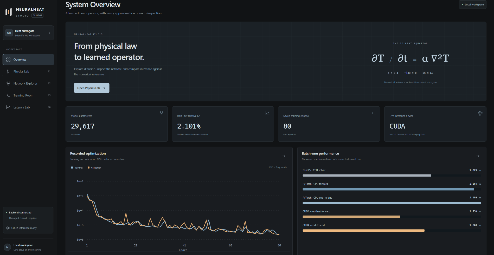
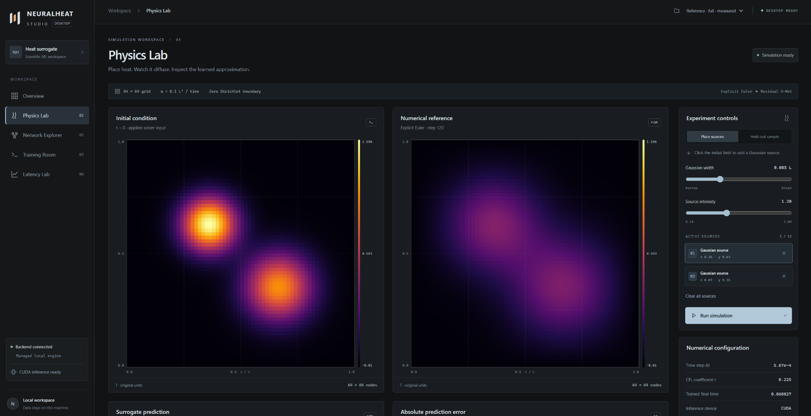
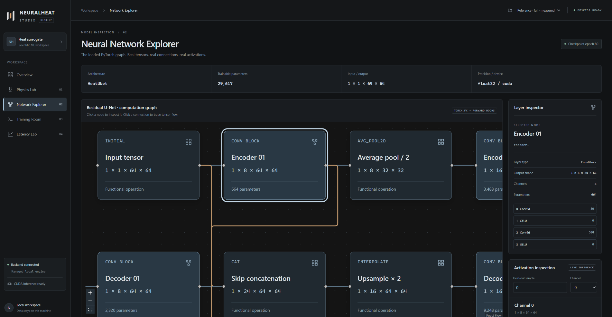
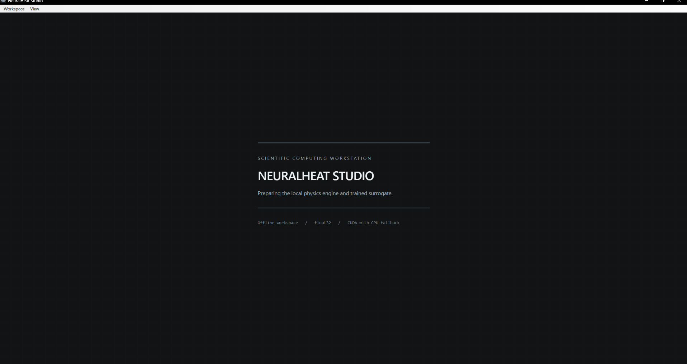
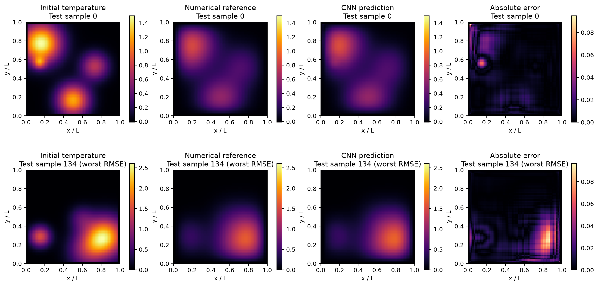
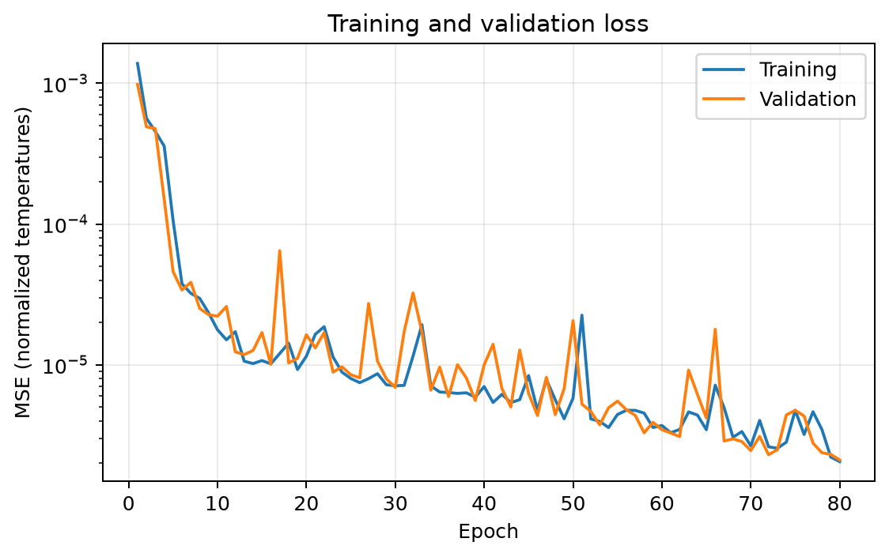
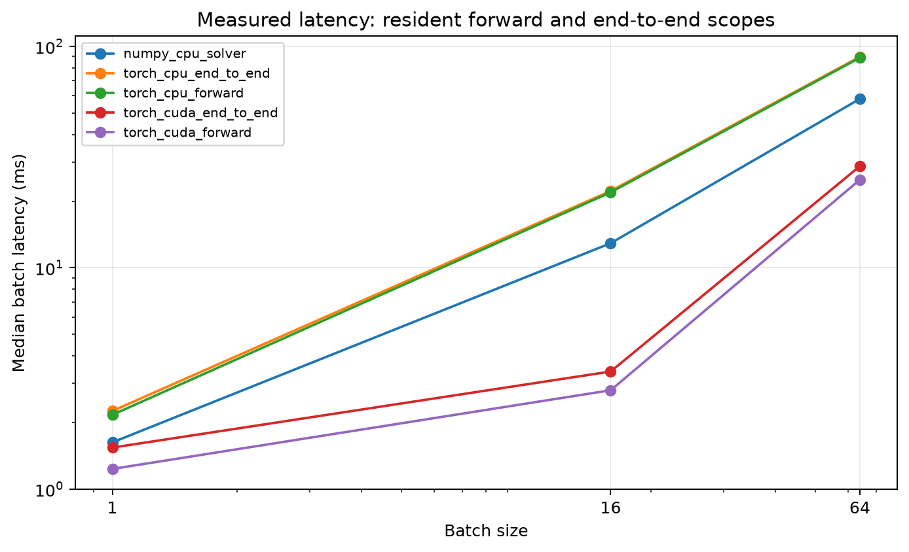

## Download NeuralHeat Studio

[**Download for Windows (.exe)**](https://github.com/musaddiq2021/neuralheat/releases/download/v1.0.0-beta.1/NeuralHeat-Studio-Setup.exe)
****

# NeuralHeat Studio

**A local scientific workstation for heat diffusion, PyTorch surrogates and measured inference performance.**

Explore an explicit finite-difference heat solver alongside a small residual U-Net. Inspect the fields, real network activations, training history and latency evidence in a native Windows application. The complete interface and Python engine run locally, with CUDA acceleration and CPU fallback.



*The actual Windows desktop interface, showing the reference experiment and local CUDA status. Open the preview to inspect it at full resolution.*

The reference experiment achieved **2.10% global relative L2 error** on **300 held-out fields**. Its strongest measured GPU comparison was **3.798× at batch 16**, including transfers. The CPU CNN was slower than the NumPy solver at every tested batch size. These are saved measurements from one laptop, not performance guarantees.

## Inside the workstation

- **Physics Lab:** place Gaussian sources, adjust intensity and width, animate numerical diffusion, and inspect initial, reference, CNN and absolute-error heatmaps. An optional Three.js surface provides a spatial view.
- **Network Explorer:** inspect the actual PyTorch tensor graph, skip connections, layer shapes, parameter counts and forward-hook activations from real inference.
- **Training Control Room:** start approved smoke/full experiments, follow epoch losses and SSE console logs, inspect available GPU telemetry, cancel safely and reopen saved runs. Opening Studio never starts training.
- **Latency Lab:** compare saved CPU/GPU timings, batch sizes, distributions, throughput and accuracy without rerunning historical experiments.

The CNN predicts **only its trained final time, step 120**. Intermediate animation frames come from the numerical solver; the CNN prediction appears at the final time.

## Interface screenshots

Real screenshots supplied by the maintainer. Select either image to view its original resolution.

| Physics Lab | Neural Network Explorer |
|:---|:---|
| [](docs/screenshots/physics.png) | [](docs/screenshots/network.png) |
| Gaussian-source controls, physical coordinates and temperature scales. The CNN/error panels continue below this captured viewport. | Real model connections and layer inspection: Encoder 01 has eight output channels and 664 parameters. |

<details>
<summary>Native desktop startup</summary>



</details>

The opening Overview presents saved training-loss and batch-one latency charts, complementing the dedicated Training Control Room and Latency Lab workspaces. All four published screenshots retain their original dimensions and pixels, with lossless PNG compression. [Capture provenance and sizes](docs/screenshots/README.md).

## Windows installation

1. Open this repository's **Releases** page and download `NeuralHeat-Studio-Setup.exe` and its published checksum/notices.
2. Run Setup. It installs under **Program Files**, creates a Start Menu shortcut and offers an optional desktop shortcut.
3. Launch **NeuralHeat Studio** from the Start Menu. No separate Python, Node.js, npm, Vite, PowerShell session or browser is needed.

The payload includes the checkpoint, datasets, numerical engine, interface and PyTorch CPU/CUDA libraries. Setup makes no downloads. **Microsoft Edge WebView2 Runtime must already be installed** for this release; Microsoft's full Evergreen Standalone Installer can supply it offline. Windows 10 1809+ / Windows 11 x64 is required. CUDA additionally requires a compatible NVIDIA driver; the CUDA Toolkit is unnecessary. CPU fallback is included.

The verified **v1.0.0-beta.1** installer is **1,813,363,530 bytes: 1.813 GB / 1.689 GiB**. It is unsigned, so Windows may show an unrecognized-publisher prompt. Actual Program Files installation, CPU/CUDA, training/cancellation, all four native workspaces, resizing, shortcuts and uninstall preservation passed; see the [verification record](docs/verification/windows-beta.json).

Runs, logs, caches, WebView2 profile and settings live in `%LOCALAPPDATA%\NeuralHeat Studio`. Uninstalling preserves personal data. The supplied checkpoint and historical reports stay separate from new experiments. The internal backend uses an available loopback port and stops with the window.

See [installer instructions](docs/INSTALLER.md), [desktop architecture](docs/DESKTOP.md), [source/installer correspondence](docs/verification/release-source.json) and the [publication record](docs/PUBLICATION.md). Distribute the verified package through this repository's GitHub Releases together with its checksums and redistributable notices/source archive.

## Scientific results

The full experiment used a **64 × 64** grid, diffusivity **α = 0.1**, zero Dirichlet boundaries and **120 explicit Euler steps**. Training/validation/test splits contain **2,000 / 300 / 300** float32 fields from independently seeded Gaussian-source mixtures. Normalization uses the training-input maximum only.

The **29,617-parameter** residual U-Net uses two pooling stages, encoder/decoder skips, a linear correction head and exact zero-boundary projection. MSE, Adam and validation-based checkpoint selection produced the recorded best checkpoint at epoch **80**.

| Held-out metric | CNN | Identity baseline: predict the initial field |
|---|---:|---:|
| MSE | 0.0000362903 | 0.0273268 |
| RMSE | 0.00602414 | 0.165308 |
| MAE | 0.00350111 | 0.0815496 |
| Global relative L2 | **2.10064%** | 57.6436% |
| Worst sample RMSE | 0.0167287 | 0.326628 |

Global relative L2 is `‖prediction − reference‖₂ / ‖reference‖₂` over the whole held-out tensor. It is not the average per-field error: mean sample relative L2 is **2.88680%**, and worst sample relative L2 is **17.9145%**. Temperature errors use the original nondimensional temperature scale; relative errors are dimensionless.





Evidence: [evaluation](reports/evaluation.json), [benchmark](reports/benchmark.json), [training history](models/training.json). Reference checkpoint SHA256:

```text
d5e2d5a88c8666101279d696f04aa32c53159399938de126642e3e745c4429d2
```

### Measured performance

Recorded on **Intel Core Ultra 9 185H + NVIDIA RTX 4070 Laptop GPU**, Windows 11, Python 3.12.10, PyTorch 2.11.0+cu128 and CUDA runtime build 12.8. Each task used **10 warmups and 100 timings**, with one PyTorch CPU intra-op thread.

**Median milliseconds per complete batch:**

| Batch | NumPy CPU solver | CPU CNN end-to-end | CUDA resident forward | CUDA end-to-end |
|---:|---:|---:|---:|---:|
| 1 | 1.6270 | 2.2558 | 1.2344 | 1.5410 |
| 16 | 12.9106 | 22.2293 | 2.7981 | 3.3997 |
| 64 | 57.9190 | 89.6271 | 24.9806 | 28.7634 |

**CUDA end-to-end distribution and throughput:**

| Batch | p95 ms | Std ms | Samples/second | CPU solver / CUDA median |
|---:|---:|---:|---:|---:|
| 1 | 2.6942 | 0.6401 | 567.51 | 1.056× |
| 16 | 6.7225 | 1.7931 | 4,002.77 | 3.798× |
| 64 | 32.2898 | 8.3029 | 2,486.01 | 2.014× |

The last column is a **cross-device** comparison. CPU-versus-CPU speedups are **0.721× / 0.581× / 0.646×** for batches 1/16/64, all slowdowns. The batch-one GPU median improvement is small; its recorded mean end-to-end time was actually greater than the solver's mean. Larger batches do not guarantee better throughput.

Forward timing uses a normalized tensor resident on the selected device. End-to-end timing starts with a raw CPU NumPy array and returns an owned CPU NumPy array, including scaling and transfers. CUDA timings use synchronized wall-clock measurements, including synchronization overhead. Models use `eval()` and `torch.inference_mode()`.

Throughput uses **batch size / mean batch time**; speedup uses **matched-batch solver median / end-to-end median**. Training, data generation, loading, plotting and HTTP/UI overhead are excluded. Recorded training took **36.429 seconds**, and dataset generation **2.885 seconds**, reported separately.



Complete statistics, raw timings and provenance: [JSON](reports/benchmark.json), [CSV](reports/benchmark.csv), [report](reports/benchmark.md).

## Physics and limitations

On the unit square:

$$
\frac{\partial T}{\partial t}=\alpha\left(\frac{\partial^2T}{\partial x^2}+\frac{\partial^2T}{\partial y^2}\right),
\qquad T|_{\partial\Omega}=0.
$$

The five-point stencil uses `Δx = 1/63`, `Δt ≈ 0.0005668934` and CFL coefficient `α Δt / Δx² = 0.225 ≤ 0.25`. The trained final time is approximately **0.06802721**. The numerical reference has second-order spatial and first-order temporal truncation error; it is **not an exact analytical solution**.

The CNN is specialized to one diffusivity, grid, boundary condition, final time and source distribution. It has no general positivity or out-of-distribution accuracy guarantee. This benchmark compares against an explicit NumPy stencil, not every optimized PDE solver. Warm serial measurements on one laptop do not establish cold-start, concurrent-service or deployment performance.

See [detailed numerical, training and benchmark methodology](docs/SCIENTIFIC_METHOD.md).

## Technology stack

| Component | Implementation |
|---|---|
| Numerical reference and surrogate | Python, NumPy, PyTorch |
| Local API and streaming logs | FastAPI, Uvicorn, Server-Sent Events |
| Interface | React, TypeScript, Vite, Tailwind CSS |
| Scientific inspection | Canvas heatmaps/charts, React Flow, Three.js |
| Windows desktop and installer | pywebview, WebView2, PyInstaller onedir, Inno Setup |
| Verification | pytest, Ruff, TypeScript, ESLint, Playwright |

## Reproduce from source

Use Python 3.12 and Node.js 22.12+ or 24 LTS for development. Installer users need neither. After cloning, run from the repository root:

```powershell
python -m venv .venv
.\.venv\Scripts\Activate.ps1
# For CUDA, install the appropriate official PyTorch wheel first.
python -m pip install -e ".[studio,dev]"
npm.cmd ci
python scripts/check_environment.py
```

Choose a CUDA wheel appropriate to your driver from the [official PyTorch selector](https://pytorch.org/get-started/locally/); CPU-only wheels use the [CPU index](https://download.pytorch.org/whl/cpu). The npm lockfile is committed. Python compatibility ranges and the [recorded scientific environment](docs/reproducibility/scientific-environment.txt) are provided; bitwise reproduction across hardware and versions is not promised.

Git excludes generated datasets and model binaries. Either place the release's verified `best.pt` in `models/` and generate its matching cache with `neuralheat-data --config configs/full.json --verify`, or train an independent experiment:

```powershell
# Small execution check; artifacts stay separate from the reference evidence.
python scripts/run_experiment.py --config configs/smoke.json --output-root runs/smoke

# Full original configuration, with a separate output directory.
python scripts/run_experiment.py --config configs/full.json --output-root runs/reproduced-full

# After installing the reference checkpoint and its matching cache:
.\scripts\start_dashboard.ps1
```

The development launcher opens `http://127.0.0.1:5173`. CLI entry points include `neuralheat-data`, `neuralheat-train`, `neuralheat-evaluate` and `neuralheat-benchmark`; each supports `--help`. Use separate output roots to preserve reference evidence. [Studio setup](docs/STUDIO.md) explains model selection and checkpoint compatibility.

Checks without rebuilding the desktop release:

```powershell
python -m pytest -q
python -m ruff check src tests scripts
npm.cmd run typecheck
npm.cmd run lint
npm.cmd test
python scripts/audit_publication.py
```

Desktop and installer build commands are in [DESKTOP.md](docs/DESKTOP.md) and [INSTALLER.md](docs/INSTALLER.md). They are developer operations, never automatic startup tasks.

## License and release materials

NeuralHeat's own source is [MIT licensed](LICENSE). Dependencies retain their licenses; see [third-party notices and redistribution review](THIRD_PARTY_NOTICES.md) and the [retained license texts](docs/licenses/). NVIDIA and Microsoft runtimes are not relicensed under MIT.

The original build is preserved. The [MSVC review](docs/MSVC_REDISTRIBUTION.md) records the accepted Community licence, archived full terms and exact official provenance for all four runtime DLLs. The unused cuSOLVERMg component is excluded through a guarded collection policy, while the verified beta retains working CPU/CUDA functionality. Complete notices and corresponding certifi source are included in the installer and release materials. The [beta release procedure](docs/BETA_RELEASE.md) documents reproduction; no licence or installation-verification issue remains open for this payload.

Publish the installer, reference checkpoint, checksums and accompanying notices as **GitHub Release assets**. Multi-gigabyte ZIPs, datasets, environments and build trees do not belong in Git. The [publication checklist](docs/PUBLICATION.md) records readiness and outstanding obligations.
